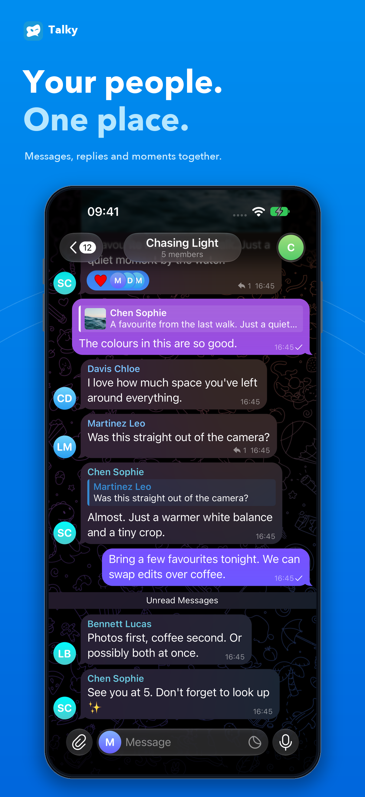
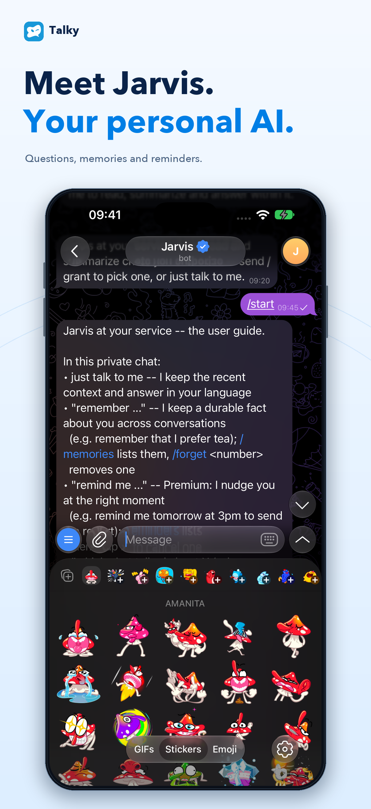
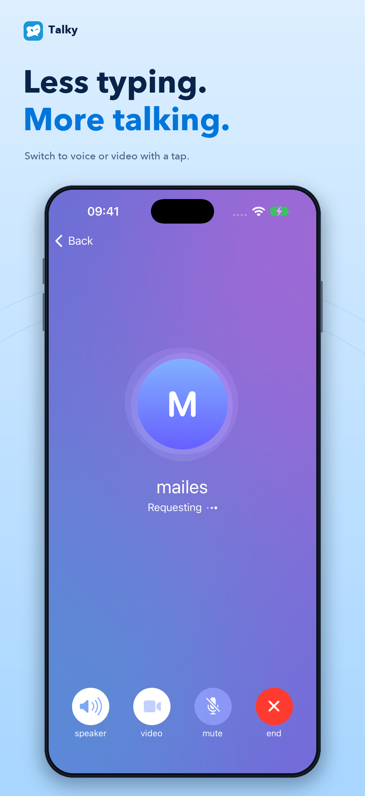
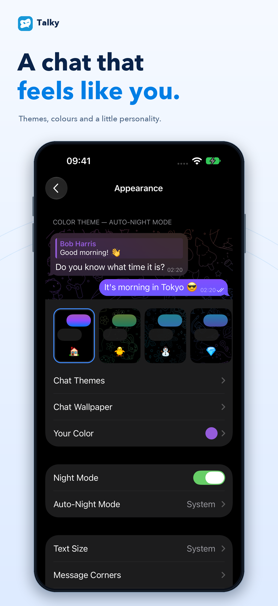

<p align="center">
  
</p>
<h1 align="center">Talky for iOS</h1>
<p align="center"><strong>Your people. Your conversations. Your personal AI.</strong></p>
<p align="center">
  <a href="https://talkytalky.im/?utm_source=github&utm_medium=readme&utm_campaign=talky_ios">Official website</a> ·
  <a href="https://talkytalky.im/download.html?utm_source=github&utm_medium=readme&utm_campaign=talky_ios">Downloads</a> ·
  <a href="docs/BUILDING.md">Build from source</a> ·
  <a href="README.zh-CN.md">简体中文</a>
</p>

Talky is a messaging app for iPhone and iPad, with private conversations, groups, voice and video calls, themes, and **Jarvis**, a personal AI assistant inside your chats. This repository contains the iOS client source, derived from Telegram-iOS and the gramsrv-compatible client.

**The iOS App Store release is currently under review.** Follow the [official download page](https://talkytalky.im/download.html?utm_source=github&utm_medium=readme&utm_campaign=talky_ios) for availability. Android and desktop download options are listed there too.

<table>
<tr>
<td></td>
<td></td>
<td></td>
<td></td>
</tr>
</table>

## What you can explore

- **Messages and groups:** replies, reactions, media, files and shared conversations.
- **Jarvis:** questions, authorised chat summaries, memories and reminders, with availability depending on the service and subscription.
- **Voice and video:** call controls alongside your conversations.
- **Your own style:** light and dark modes, chat themes and appearance controls.
- **iPhone and iPad:** phone layouts and a tablet sidebar for larger screens.

Screenshots show the real app with marketing headings outside the interface. The call screenshot depicts a call request; it does not claim that a call is connected.

## Run and build

The client is built with **Bazel through `build-system/Make/Make.py`**. The pinned tool versions are in [`versions.json`](versions.json); this source snapshot uses Xcode 27.1 and Bazel 9.2.0. A different Xcode version requires the explicit override described in the build guide.

```sh
git clone --recurse-submodules https://github.com/mailes/talky-ios.git
cd talky-ios
cp build-system/talky-configuration.example.json \
   build-system/talky-configuration.local.json
# Fill in your own API ID, API hash, Apple team and bundle ID.
scripts/build-ios.sh --no-launch
```

Start with [the build guide](docs/BUILDING.md). Real signing certificates, provisioning profiles, API credentials and operator configuration are deliberately excluded. Keep them outside Git.

## How this repository relates to Talky

This is the **iOS client**, not the Talky backend or an AI model. The current client connects to Talky's service. Publishing client code does not grant access to production infrastructure, signing credentials, subscription entitlements or third-party AI services. Chat privacy, server processing and optional AI features are described in the [privacy policy](https://talkytalky.im/privacy.html).

The initial public snapshot is based on the source used for Talky 1.0 (2), with public build examples, credential removal and documentation changes. It is **not a byte-for-byte reproducible release claim**. Legacy Foursquare/Google short-link handling without developer credentials shares the original URL instead.

## Contribute

Bug reports and focused pull requests are welcome. Include the device, iOS version, reproduction steps and screenshots when reporting UI problems. Keep credentials, personal conversations and verification codes out of issues and patches.

See [CONTRIBUTING.md](CONTRIBUTING.md) and [SECURITY.md](SECURITY.md). Small documentation and build-example improvements are useful contributions too.

## License and acknowledgements

Telegram identifies Telegram for iOS as **GNU GPL version 2 or later**; this derivative retains that licensing basis. See [LICENSE](LICENSE), [NOTICE.md](NOTICE.md), and the individual licenses of bundled dependencies. Original copyright and attribution notices remain in the source. This project is independent of Telegram and is not an official Telegram application.

- [Telegram-iOS](https://github.com/TelegramMessenger/Telegram-iOS)
- [gramsrv-compatible iOS fork](https://github.com/iamxvbaba/gramsrv-Telegram-iOS)
- The maintainers of the third-party projects and submodules included here.

Learn more about Talky at **[talkytalky.im](https://talkytalky.im/?utm_source=github&utm_medium=readme&utm_campaign=talky_ios)**.
